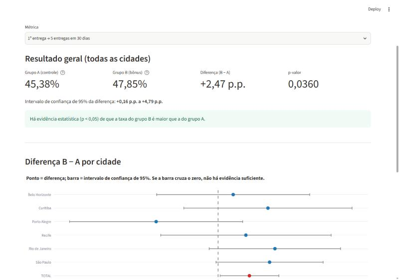
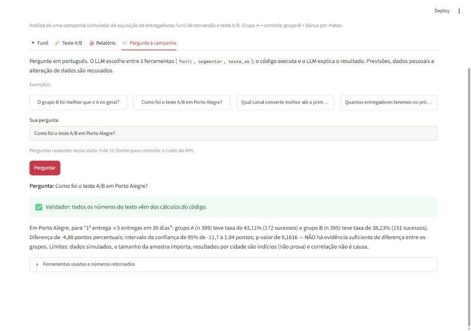
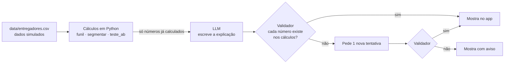

# Copiloto de Growth

> ⚠️ **Dados 100% simulados.** Todos os números deste projeto são fictícios, gerados por
> [`src/simular_dados.py`](src/simular_dados.py) com semente fixa. Os efeitos da campanha foram
> **definidos por mim** para fins de demonstração. Nada aqui representa dados reais de qualquer empresa.

App em português que analisa uma campanha (simulada) de aquisição de entregadores: calcula o
funil de conversão, compara um teste A/B e usa um LLM para **explicar** o resultado, com limites
e riscos, e gerar um relatório curto de recomendação.

**A regra central:** os números vêm do código Python, nunca do LLM. O LLM só recebe números já
calculados e escreve a explicação; um validador confere se cada número do texto existe nos cálculos.

## 🔗 Links

- **App online:** _(link do Streamlit Community Cloud — em breve)_
- **Vídeo de demonstração:** _(em breve)_

## O que o app faz

| Aba | O que mostra |
|---|---|
| 🔻 **Funil** | Cadastro → documentos → aprovado → 1ª entrega → 5 entregas em 30 dias, com quedas por etapa e comparação por cidade ou canal |
| 🧪 **Teste A/B** | Grupo B (bônus por metas) vs A (controle): taxas, diferença em pontos percentuais, intervalo de confiança de 95%, p-valor e o resultado **por cidade** |
| 📝 **Relatório** | O LLM escreve resumo, o que os dados mostram, riscos e limites, recomendação e próximo teste. Download em Markdown |
| 💬 **Pergunte à campanha** | Perguntas em português; o LLM escolhe entre 3 ferramentas de cálculo. Previsões, dados pessoais e alteração de dados são recusados |





O caso foi desenhado para exigir **senso crítico**: no total, B ganha por pouco
(+2,47 p.p., p = 0,036, intervalo de 0,16 a 4,79), mas o efeito não é uniforme — em Porto Alegre
a diferença é negativa e nenhuma cidade, isoladamente, tem evidência suficiente.
O app mostra isso em vez de apenas dizer "B ganhou".

## Como rodar localmente

Requer Python 3.10+.

```bash
python -m venv .venv
.venv\Scripts\activate          # Windows  (Linux/Mac: source .venv/bin/activate)
pip install -r requirements.txt
```

Copie `.env.example` para `.env` e preencha `OPENAI_API_KEY` (só é necessário para as abas
Relatório e Pergunte; Funil e Teste A/B funcionam sem chave).

```bash
streamlit run app.py         # abre o app
pytest                       # 37 testes, sem chamar a API (usa um LLM falso)
python -m tests.avaliar      # avaliação com perguntas reais (gasta créditos da API)
python -m src.simular_dados  # regenera data/entregadores.csv (mesmo resultado sempre)
```

## Como funciona



**Modo "Pergunte à campanha":**
1. Filtro de escopo em código (palavras-chave): recusa previsões, dados pessoais e alteração de dados sem chamar o LLM.
2. O LLM escolhe ferramentas via *function calling* (`funil`, `segmentar`, `teste_ab`). Se não escolher nenhuma, a pergunta é tratada como fora do escopo.
3. O código valida os argumentos e executa as ferramentas.
4. O LLM responde só com base nos resultados; o validador confere os números.

| Arquivo | Papel |
|---|---|
| [`src/simular_dados.py`](src/simular_dados.py) | Gera os dados simulados |
| [`src/metricas.py`](src/metricas.py) | Funil e segmentação |
| [`src/abteste.py`](src/abteste.py) | Teste de duas proporções (statsmodels) |
| [`src/ferramentas.py`](src/ferramentas.py) | Ferramentas expostas ao LLM, com validação de argumentos |
| [`src/agente.py`](src/agente.py) | Orquestra LLM + ferramentas + validador; prompts e regras |
| [`src/validador.py`](src/validador.py) | Confere se os números do texto existem nos cálculos |
| [`src/llm.py`](src/llm.py) | Único arquivo que conhece o provedor (OpenAI, `gpt-5-mini`) |

## Decisões

- **Cálculo no código, não no LLM.** LLMs erram contas e podem "inventar" números plausíveis. Em
  código, o resultado é exato, reproduzível e testável. O LLM fica com o que faz bem: explicar.
- **Números formatados pelo código.** O código já envia os números no formato brasileiro
  (20.000; 45,38%); o LLM só copia. Na 1ª avaliação, o LLM ignorou a instrução de formato.
- **Pontos críticos calculados pelo código.** Cidades com diferença negativa são detectadas em
  Python e enviadas como "destaques" que o relatório deve citar — não depende de o LLM perceber.
- **Cabeçalho "dados simulados" adicionado pelo código**, nunca pelo LLM.
- **Recusa em duas camadas:** palavras-chave (previsível e testável) + decisão do LLM de não usar ferramentas.
- **Provedor isolado em `src/llm.py`:** trocar de provedor exige mudar só esse arquivo.
- **Controle de custo no app público:** o relatório é gerado uma vez e reaproveitado por 24 h
  (os dados são fixos) e há limite de 10 perguntas por visita.

## Como os dados foram gerados

- 20.000 candidatos, 90 dias de cadastro (a partir de 01/01/2026), semente `42`.
- 6 cidades, 3 canais (indicação, anúncio, orgânico), grupos A e B sorteados 50/50.
- Probabilidades de cada etapa variam por canal (valores em `src/simular_dados.py`).
- **Efeito definido por mim:** o grupo B altera a etapa "1ª entrega → 5 entregas" em
  +5 p.p. (São Paulo), +4 (Rio de Janeiro), +3 (Belo Horizonte), +1 (Curitiba), 0 (Recife)
  e −7 p.p. (Porto Alegre). Os valores observados diferem um pouco disso por causa do sorteio.
- Simplificação: assume-se que todos tiveram 30 dias completos de observação após a 1ª entrega.

## Avaliação

**Testes automáticos (`pytest`, 37 testes, sem API):** funil bate com o CSV, teste A/B com
diferença conhecida e sem diferença, validador detecta número inventado, recusas, nova tentativa
do validador, formatação e cobertura das 6 cidades.

**Avaliação com o LLM real** ([`tests/avaliar.py`](tests/avaliar.py)): 10 perguntas com o
comportamento esperado definido antes de rodar (7 que devem ser respondidas, 3 que devem ser recusadas).

| Rodada | Resultado | O que aconteceu |
|---|---|---|
| [1ª](docs/avaliacao_v1.md) | 9/10 | **Falha registrada:** respondeu "7148" e "35.74%", ignorando o formato brasileiro. **Falha escondida** (a avaliação marcou acerto): na pergunta "qual cidade teve o pior resultado?", o agente consultou só 4 das 6 cidades (limite de 4 chamadas por pergunta) e acertou Porto Alegre por sorte |
| [2ª](docs/avaliacao.md) | 10/10 | Após as correções: números formatados pelo código; `teste_ab` ganhou a opção `por_cidade` (6 cidades em uma chamada); aviso quando chamadas são cortadas; avaliação passou a exigir as 6 cidades |

As 2 perguntas de recusa que **escapam** da lista de palavras-chave ("Quantos entregadores
teremos em dezembro?" e "dados do entregador de id 123") foram recusadas pelo LLM nas duas rodadas.

### Limitações e problemas conhecidos

- **Avaliação pequena:** 10 perguntas, 2 rodadas. O LLM não é determinístico; 10/10 não garante
  o mesmo resultado sempre.
- **Validador de números:** o relatório recebe ~140 números, então um número inventado pode
  coincidir por acaso com um real e passar (ex.: "37,9" existe nos dados). O validador também
  não confere o **contexto** (ex.: a taxa de uma cidade atribuída a outra).
- **Filtro de escopo:** a lista de palavras-chave é limitada; perguntas formuladas de outro jeito
  dependem do LLM para serem recusadas.
- **Estatística:** olhar 6 cidades sem correção para comparações múltiplas aumenta a chance de
  achar diferença por acaso (o app avisa, mas não corrige). Intervalo de Wald (aproximação normal).
- **Limite de perguntas por visita** é por sessão do navegador (recarregar a página zera). A
  proteção real de custo é o limite de gasto configurado na conta da API.
- **Windows:** o pyarrow 26 foi bloqueado pelo Controle de Aplicativo Inteligente; a versão está fixada em 25.0.1.

## Próximos passos

- Ampliar a avaliação (mais perguntas, várias rodadas por pergunta, medir variação).
- Validador que confira também o contexto do número (qual métrica/cidade ele representa).
- Correção para comparações múltiplas (ex.: Holm) nos resultados por cidade.
- Análise de poder: tamanho de amostra necessário para detectar o efeito por cidade.
- Comparar provedores/modelos de LLM com a mesma avaliação.
